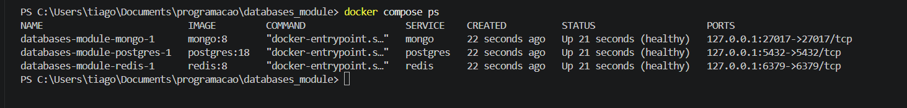

# Session 01: Database Engines and Diagnosis - Solutions

## Exercise 1

## Exercise 2: The Database Data Model (`s01_fastapi`)

### Table List and Attributes
The relational model centralized and generated via `app/clients.py` in PostgreSQL contains the following tables:

* **Table: `hello`**
  * `id` (`INTEGER`): Primary Key, automatically generated sequentially (`GENERATED ALWAYS AS IDENTITY PRIMARY KEY`).
  * `msg` (`TEXT`): Message or record content (`NOT NULL`).
  * `created_at` (`TIMESTAMPTZ`): Creation timestamp with a default value (`NOT NULL DEFAULT now()`).

* **Table: `items`**
  * `id` (`INTEGER`): Primary Key, automatically generated sequentially (`GENERATED ALWAYS AS IDENTITY PRIMARY KEY`).
  * `hello_id` (`INTEGER`): Foreign Key referencing `hello(id)` (`REFERENCES hello(id) ON DELETE CASCADE`).
  * `name` (`TEXT`): Name of the item (`NOT NULL`).
  * `price` (`NUMERIC(10, 2)`): Price of the item (`NOT NULL`).
  * `created_at` (`TIMESTAMPTZ`): Creation timestamp with a default value (`NOT NULL DEFAULT now()`).

### Relationships
* **`hello` 1 <───> `items` (One-to-Many):** One record in the `hello` table can have multiple associated `items`. The `items.hello_id` foreign key links each item back to its corresponding parent record in `hello`.

---

## Exercise 3: Three Concrete Problems in the Data Model

1. **Missing Temporal Index on `created_at` Columns**
   * **File & Line:** `app/clients.py` (inside the `create_tables()` function, table definitions)
   * **Problem:** Neither `created_at` column has an associated index (`CREATE INDEX`). As data scale increases, queries sorted or filtered by date will force the database to perform full sequential scans, significantly hurting performance.

2. **Lack of Validation / Constraints on Fields**
   * **File & Line:** `app/clients.py` (table definitions for `hello` and `items`)
   * **Problem:** Fields like `msg` or `name` accept arbitrary text without minimum size/content validation checks (e.g., `CHECK (length(name) > 0)`), and `price` lacks a constraint to prevent negative values (e.g., `CHECK (price >= 0)`).

3. **Risk of Cascading Deletes Without Soft Delete Safeguards**
   * **File & Line:** `app/clients.py` (foreign key definition in the `items` table)
   * **Problem:** Using `ON DELETE CASCADE` on `hello_id` means deleting a parent record in `hello` will automatically and permanently purge all linked `items` without warning or soft-delete safeguards.

---

## Exercise 4: Behavior with Scale and Concurrent Writes

* **Scale with 100,000 records:**
  * Lookups by primary key (`id`) or foreign key (`hello_id`) remain high-performance if indexed.
  * Queries filtering by date ranges or sorting by `created_at` become progressively slower without secondary indexes.
* **Concurrent Writes (Simultaneous Users):**
  * PostgreSQL manages concurrent write operations securely through its transactional isolation engine (ACID). Row-level locks (*row-level locking*) ensure data integrity and prevent data loss or corruption during simultaneous accesses.

## Exercise 5: Suitability for MongoDB and Redis

While relational databases like PostgreSQL excel at handling structured data with strict relationships, ACID guarantees, and complex joins, certain data patterns benefit significantly from alternative database engines:

* **MongoDB (Document-Oriented NoSQL Database):**
  * **When it fits better:** MongoDB is ideal if the data structure is semi-structured, highly nested, or prone to frequent schema changes (e.g., storing user profiles with dynamic attributes, product catalogs with varying specifications, or raw JSON event logs). 
  * **Why:** Instead of splitting data across multiple normalized tables and joining them back (like `hello` and `items`), MongoDB allows you to store related records as **embedded documents** inside a single BSON document. This eliminates the need for expensive JOIN operations and matches modern application payloads (like JSON APIs) natively.

* **Redis (In-Memory Key-Value Store):**
  * **When it fits better:** Redis is optimal for high-throughput, low-latency workloads where data retrieval speed is the absolute priority, such as user session storage, real-time leaderboards, rate-limiting counters, caching database queries, or pub/sub message brokers.
  * **Why:** Because Redis stores all data directly in **RAM** (main memory) rather than on disk, read and write operations happen in microseconds (handling millions of operations per second). However, it lacks the complex query capabilities and relational integrity of PostgreSQL, making it unsuitable as a primary persistent store for relational business data.