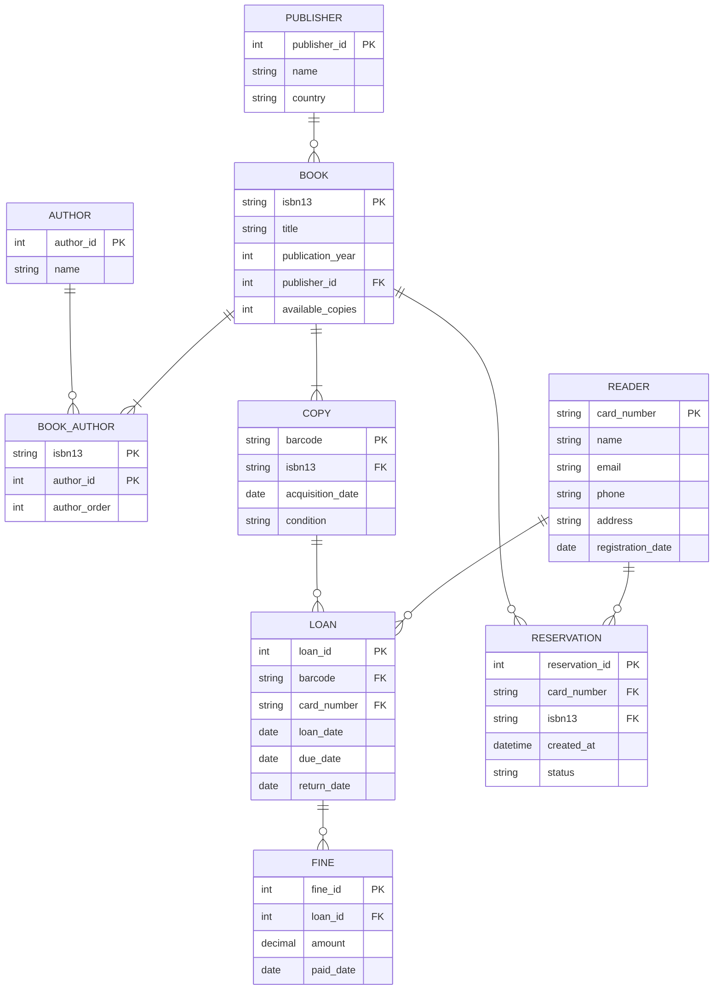

# Municipal library: data model

## Task 1: ER diagram

## Task 2: Tables in 3NF

Each table holds a single source of facts. Every non-key attribute depends on the whole primary key and nothing else.

| Table | Columns | Primary key | Foreign keys | UNIQUE |
|---|---|---|---|---|
| `publisher` | publisher_id, name, country | publisher_id | none | name |
| `book` | isbn13, title, publication_year, publisher_id, available_copies | isbn13 | publisher_id → publisher | none |
| `author` | author_id, name | author_id | none | none |
| `book_author` | isbn13, author_id, author_order | (isbn13, author_id) | isbn13 → book, author_id → author | (isbn13, author_order) |
| `copy` | barcode, isbn13, acquisition_date, condition | barcode | isbn13 → book | none |
| `reader` | card_number, name, email, phone, address, registration_date | card_number | none | email |
| `loan` | loan_id, barcode, card_number, loan_date, due_date, return_date | loan_id | barcode → copy, card_number → reader | none |
| `reservation` | reservation_id, card_number, isbn13, created_at, status | reservation_id | card_number → reader, isbn13 → book | none |
| `fine` | fine_id, loan_id, amount, paid_date | fine_id | loan_id → loan | none |

Notes:

- `book_author` resolves the N:N relationship between books and authors. The author order is stored in `author_order`, and the UNIQUE `(isbn13, author_order)` makes sure two authors cannot take the same position on one book.
- `condition` only accepts `new`, `good`, `worn` or `damaged` (CHECK constraint).
- `status` of a reservation only accepts `active`, `fulfilled` or `cancelled` (CHECK constraint).
- `publisher` has a surrogate key (`publisher_id`) and a UNIQUE `name`. The country depends on the publisher, not on the book, so it does not belong in `book`.
- `address` is a single text column. If the library needs reports by city, split it into `city` and `postcode`, because the postcode determines the city (a 3NF violation).

## Task 3: Business rules and where they are enforced

| Rule | Where to enforce | How |
|---|---|---|
| Reader card number and email are unique | Constraint | PRIMARY KEY and UNIQUE |
| ISBN-13 is unique | Constraint | PRIMARY KEY |
| A book has exactly one publisher | Structure | `book.publisher_id NOT NULL` |
| A book has one or more authors | Application | A table cannot enforce "at least one row in `book_author`". When a book is created, the application inserts at least one `book_author` row in the same transaction |
| Author order is unique per book | Constraint | UNIQUE `(isbn13, author_order)` |
| A book has at least one copy | Application | Same approach as the authors rule |  
| Copy condition | Constraint | CHECK on `condition` |
| Due date = loan date + 14 days | Constraint | `due_date` as a generated column: `GENERATED ALWAYS AS (loan_date + 14) STORED` |
| A copy can be in at most one open loan | Constraint | Partial unique index: `CREATE UNIQUE INDEX ON loan (barcode) WHERE return_date IS NULL` |
| A reader has at most 5 open loans | Trigger | `BEFORE INSERT` on `loan` counts the reader's open loans and raises an error if there are already 5. Locking the reader row (`SELECT ... FOR UPDATE`) stops two simultaneous loans from both passing the limit |
| A reservation is only allowed when no copy is available | Application | Check `available_copies = 0` before inserting the reservation |
| Reservations are served in order | Application | `ORDER BY created_at, reservation_id` |
| Fine of 0.50 per day late | Application | `amount = 0.50 × days late`, calculated at return. CHECK `amount >= 0` |
| A fine is only created for a late return | Application | Created only when `return_date > due_date` |
| Payment date is empty until paid | Structure | `paid_date` is nullable by default |

## Task 4: Denormalisation

Store `available_copies` in the `book` table.

**Why:** the reservation rule and the catalogue listing both need to know how many copies of each book are available. Without the column, every query would have to count the copies and check the open loans for every book.

**Cost:** the value has to be updated on every loan and every return. This is done with a trigger, or in the same transaction as the loan, so that it never drifts out of sync.

**Decision:** I make this denormalisation and document it here. The source of truth stays in `copy` and `loan`. If the counter and reality ever disagree, it is recalculated from those tables.