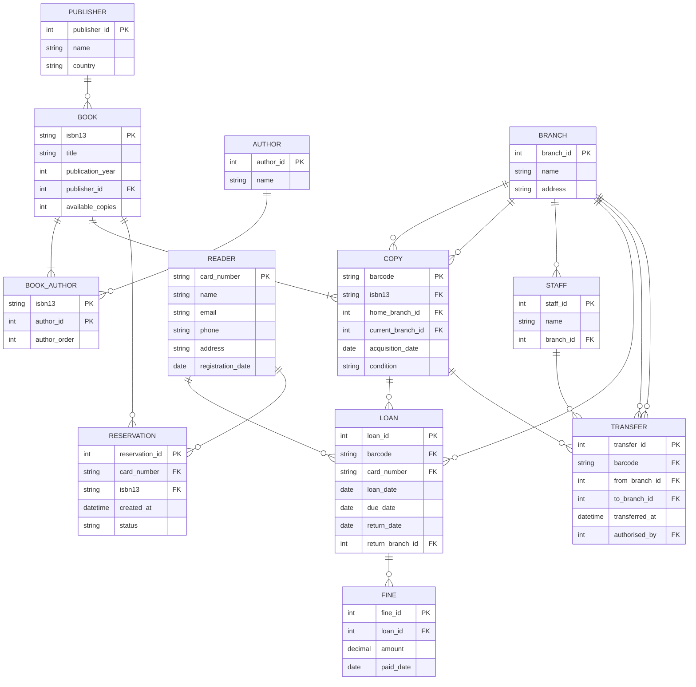

# Library with three branches: extended model

## Task 1: Extended ER diagram

The diagram adds `branch`, `staff` and `transfer`, and changes `copy` and `loan`. The rest of the tables are the same as in the exercise.



### New and changed tables

**New tables**

| Table | Columns | Primary key | Foreign keys | UNIQUE and constraints |
|---|---|---|---|---|
| `branch` | branch_id, name, address | branch_id | none | name |
| `staff` | staff_id, name, branch_id | staff_id | branch_id → branch | none |
| `transfer` | transfer_id, barcode, from_branch_id, to_branch_id, transferred_at, authorised_by | transfer_id | barcode → copy, from_branch_id → branch, to_branch_id → branch, authorised_by → staff | `CHECK (from_branch_id <> to_branch_id)` |

Indexes on `transfer`:

- `(from_branch_id, transferred_at)`: for "which copies left branch Y".
- `(barcode, transferred_at)`: for the full history of one copy.

**Changed tables**

| Table | Change | Reason |
|---|---|---|
| `copy` | `home_branch_id` (FK → branch, NOT NULL) | Every copy has a home branch |
| `copy` | `current_branch_id` (FK → branch, NOT NULL) | Current location, so nobody has to read the history |
| `loan` | `return_branch_id` (FK → branch, NULL until returned) | A copy can be returned at any branch |

## Task 2: Queries the model must answer

**Q1: Where is copy X now?**

```sql
SELECT b.name
FROM copy c
JOIN branch b ON b.branch_id = c.current_branch_id
WHERE c.barcode = 'X';
```

Answered by `copy` (primary key lookup on `barcode`) and `branch`. It does not read `transfer`.

**Q2: Which copies left branch Y last month?**

```sql
SELECT DISTINCT t.barcode, t.transferred_at, t.to_branch_id
FROM transfer t
WHERE t.from_branch_id = :branch_y
  AND t.transferred_at >= date_trunc('month', now()) - interval '1 month'
  AND t.transferred_at <  date_trunc('month', now());
```

Answered by `transfer`, using the index `(from_branch_id, transferred_at)`.

### How the two stay consistent

- A transfer inserts a row in `transfer` and updates `copy.current_branch_id` in the **same transaction**. The two tables cannot disagree.
- A return at a branch different from `copy.current_branch_id` also inserts a row in `transfer` (from the current branch to `return_branch_id`) and updates `current_branch_id`.
- A return at the branch where the copy already is creates no transfer.

## Task 3: BCNF

**Answer: no table in this model is in 3NF and not in BCNF.** Every table is in BCNF.

BCNF requires that the left side of every non-trivial functional dependency (FD) is a superkey. 3NF is weaker: the right side can also be a prime attribute (part of some candidate key).

The check, table by table:

| Table | Candidate keys | Functional dependencies | Left sides are superkeys? |
|---|---|---|---|
| `branch` | branch_id, name | branch_id → name, address; name → branch_id, address | Yes |
| `staff` | staff_id | staff_id → name, branch_id | Yes |
| `copy` | barcode | barcode → isbn13, home_branch_id, current_branch_id, acquisition_date, condition | Yes |
| `transfer` | transfer_id, (barcode, transferred_at)* | transfer_id → all; (barcode, transferred_at) → from_branch_id, to_branch_id, authorised_by | Yes |
| `loan` | loan_id | loan_id → all other columns | Yes |
| `book_author` | (isbn13, author_id), (isbn13, author_order) | (isbn13, author_id) → author_order; (isbn13, author_order) → author_id | Yes |
| `book`, `author`, `publisher`, `reader`, `reservation`, `fine` | their primary key (and UNIQUE columns) | key → other columns | Yes |

\* Assuming a copy cannot be transferred twice at the same instant.

**Why `copy.current_branch_id` does not break BCNF.** Inside `copy`, the current branch is not determined by the other columns of the same row. It is determined by the latest row of `transfer`, which is a fact about another table and a point in time. So it is not an FD of `copy`, and the table is in BCNF. It is a deliberate denormalisation that exists to make Q1 fast.

**The only table with overlapping candidate keys is `book_author`.** It might look like the case that breaks BCNF, but both FDs have a candidate key on the left, so it is in BCNF.

### Example: a table in 3NF but not in BCNF

Take a table `cataloguing (isbn13, language, cataloguer)` with these rules:

- A book in a given language has one cataloguer: `{isbn13, language} → cataloguer`.
- Each cataloguer works in one language only: `cataloguer → language`.

The candidate keys are `{isbn13, language}` and `{isbn13, cataloguer}`.

- **3NF holds:** `cataloguer → language` is allowed, because `language` is a prime attribute (it belongs to the key `{isbn13, language}`).
- **BCNF fails:** in `cataloguer → language`, the left side `cataloguer` is not a superkey.

The BCNF decomposition is `cataloguer(cataloguer, language)` and `book_cataloguer(isbn13, cataloguer)`. However, the rule `{isbn13, language} → cataloguer` can no longer be checked inside one table, so the decomposition loses a dependency. This is why 3NF is sometimes kept on purpose. The library model does not have this situation.